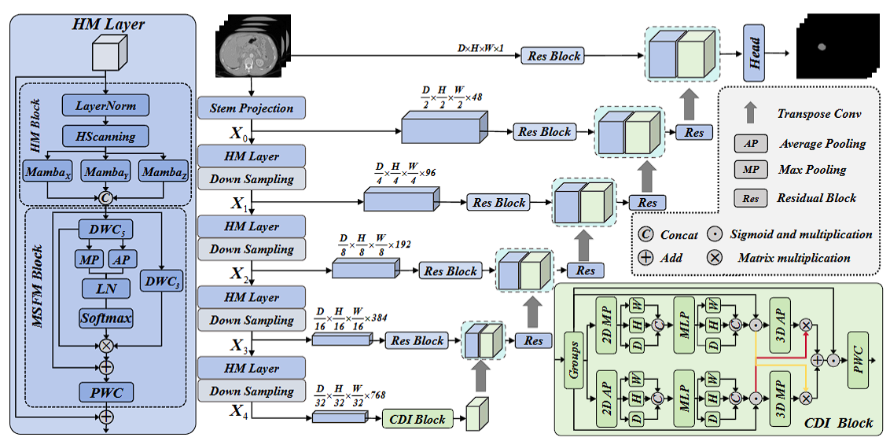
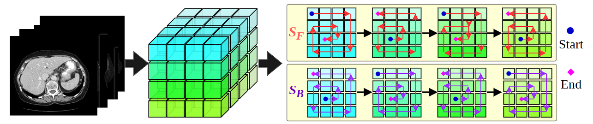
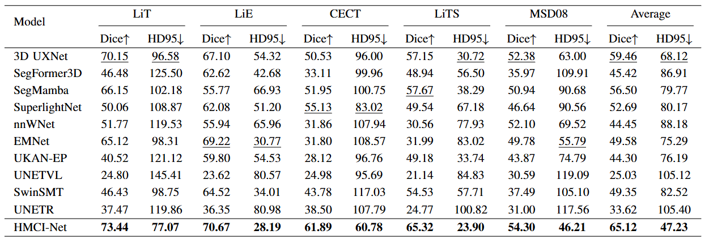
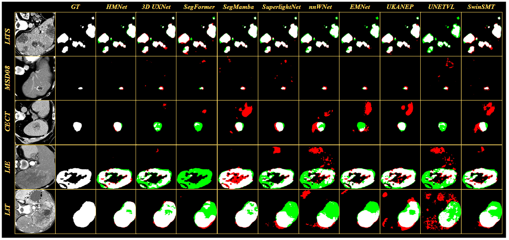
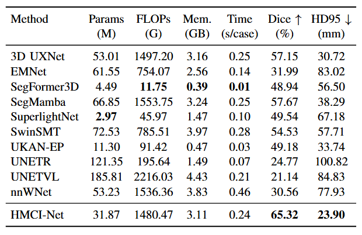
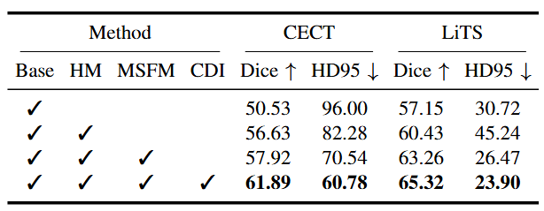
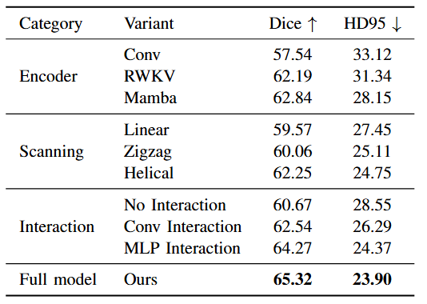

# HMCI-Net

**Toward Accurate Liver Tumor Segmentation via Helical Mamba and Cross-Directional Interaction**

> **Venue:** IEEE BIBM 2026  
> **Status:** Accepted

<div>
  <a href="https://www.python.org/"></a>
  <a href="https://pytorch.org/"></a>
  
  
</div>

## News

- **2026:** Our paper has been accepted at **IEEE BIBM 2026**!

## Overview

This repository provides the PyTorch implementation of **HMCI-Net**. The release contains the core network code, a LiTS training/evaluation example, and manuscript figures.

<p align="center">
  
</p>

## Highlights

HMCI-Net is a 3D liver tumor segmentation framework for contrast-enhanced CT. It is designed around two observations: common volumetric scanning patterns may disrupt inter-slice voxel continuity, and conventional bottleneck designs often lack explicit cross-directional high-level interaction. The manuscript also introduces a large-scale liver tumor dataset to support more comprehensive evaluation of liver tumor and tumor-enhancement segmentation.

**Key Contributions:**

1. **HMCI-Net with continuity-aware Mamba modeling and cross-directional interaction.** We propose HMCI-Net, a 3D segmentation framework built with a **Helical Mamba (HM) Layer**, **Alternating Helical Scanning**, **Multi-scale Structural Feature Modulation (MSFM)**, and a **Cross-Directional Interaction (CDI) Block**. These modules preserve inter-slice continuity, enhance structural details, and strengthen bottleneck-level directional interaction for liver tumor localization.
2. **A large-scale liver tumor dataset.** We construct **LiTE**, a contrast-enhanced CT dataset for liver tumor analysis. It contains **529 LiT cases** with whole-tumor annotations, including **171 LiE cases** with additional intratumoral enhancement-region annotations. The dataset itself is not redistributed in this repository due to data governance requirements; the release notice is provided below.
3. **Strong segmentation performance.** Extensive experiments show that HMCI-Net achieves accurate and robust liver tumor segmentation, with consistent gains in quantitative comparison, qualitative visualization, complexity analysis, and ablation studies across LiT, LiE, CECT, LiTS, and MSD08.

**Core Implementation Components:**

- **Helical Mamba (HM) Layer:** combines tri-directional bidirectional helical Mamba modeling with multi-scale structural modulation.
- **Alternating Helical Scanning:** serializes volumetric features into forward and reverse helical sequences while preserving cross-slice continuity.
- **Multi-scale Structural Feature Modulation (MSFM):** fuses volumetric receptive-field responses and local structural responses to enhance fine details.
- **Cross-Directional Interaction (CDI) Block:** strengthens bottleneck-level cross-directional interaction and lesion-aware localization.
- **LiTS Example Pipeline:** provides a public-dataset example for training, validation, and reproducible code usage.

## Method At A Glance

Let an input CT volume be denoted as:

$$
I \in \mathbb{R}^{1 \times D \times H \times W},
\quad
Y \in \{0,1,2\}^{D \times H \times W}.
$$

Here, labels `0`, `1`, and `2` correspond to background, liver, and tumor in the LiTS-style setting. The encoder produces hierarchical features:

$$
X_i \in \mathbb{R}^{C_i \times D_i \times H_i \times W_i},
\quad i \in \{0,1,2,3,4\}.
$$

### Helical Mamba Layer

Each HM layer first normalizes the input feature and then sends it to a tri-directional helical Mamba block. The feature is scanned along three orthogonal views, and each view contains a forward helical sequence and a reverse helical sequence:

$$
\{S_F^a, S_B^a\}, \quad a \in \{D,H,W\}.
$$

The helical scan traverses neighboring slices and in-plane regions in an alternating manner, reducing direction-dependent bias and improving continuity-aware long-range modeling.

<p align="center">
  
</p>

### Multi-scale Structural Feature Modulation

After helical Mamba modeling, the feature $\hat{X}_i$ is refined using volumetric and local depthwise convolutions:

$$
F_v = \mathrm{DWC}_5(\hat{X}_i), \qquad F_l = \mathrm{DWC}_3(\hat{X}_i),
$$

$$
F_a = \mathrm{Softmax}\left(\mathrm{LN}\left(\frac{\mathrm{GAP}(F_v)+\mathrm{GMP}(F_v)}{2}\right)\right).
$$

The HM layer output combines channel modulation, local structural features, and residual connections:

$$
Y_i = X_i + \mathrm{PWC}\left((F_v \odot F_a)\odot F_l + \hat{X}_i\right).
$$

### Cross-Directional Interaction Block

At the bottleneck, CDI divides the channels of $X_4$ into $G$ groups. Average- and max-pooling branches construct directional gates along the depth, height, and width axes. The directionally weighted features $\tilde{F}_{\mathrm{avg}}^g$ and $\tilde{F}_{\mathrm{max}}^g$ then interact through cross-branch spatial weighting:

$$
q_{\mathrm{avg}}^g = \mathrm{Softmax}(\mathrm{GAP}(\tilde{F}_{\mathrm{avg}}^g)), \qquad
q_{\mathrm{max}}^g = \mathrm{Softmax}(\mathrm{GMP}(\tilde{F}_{\mathrm{max}}^g)),
$$

$$
A^g = q_{\mathrm{avg}}^g \otimes \tilde{F}_{\mathrm{max}}^g
    + q_{\mathrm{max}}^g \otimes \tilde{F}_{\mathrm{avg}}^g,
$$

where $\otimes$ denotes matrix multiplication with spatially flattened features. The final output merges the grouped features after sigmoid spatial weighting:

$$
F_{\mathrm{CDI}} = \mathrm{PWC}\left(\mathrm{R}\left(X_g \odot \sigma(A^g)\right)\right).
$$

Here, $\mathrm{R}$ restores the original batch and channel dimensions. CDI strengthens lesion-aware localization by combining directional gating with average-max branch interaction.

## Repository Structure

```text
GitHub/
|-- README.md
|-- requirements.txt
|-- .gitignore
|-- assets/
|   |-- architecture.png
|   |-- helical_scanning.png
|   |-- quantitative_results.png
|   |-- qualitative_results.png
|   |-- complexity_table.png
|   |-- ablation_components.png
|   `-- ablation_design.png
`-- Code/
    |-- 1_Train_LITS_main.py
    |-- Reference_LITS.py
    |-- load_datasets_transforms.py
    |-- networks/
    |   `-- Heiix_Mamba/
    |       `-- HM.py
    |-- light_training/
    |-- monai_utils/
    `-- data_process/
```

## Environment

The code was developed with Python 3.10+, PyTorch, and MONAI.

```bash
conda create -n hmci_net python=3.10 -y
conda activate hmci_net

# Install a PyTorch build matching your CUDA version.
# Example for CUDA 11.8:
pip install torch torchvision torchaudio --index-url https://download.pytorch.org/whl/cu118

pip install -r requirements.txt
```

## Dataset Preparation

This release uses **LiTS** as the public-dataset example. Please download LiTS from the official source and convert images and labels to NIfTI format if needed.

Arrange the processed data as:

```text
data/
`-- LITS/
    `-- crop/
        |-- imagesTr/
        |   |-- case_000.nii.gz
        |   `-- ...
        |-- labelsTr/
        |   |-- case_000.nii.gz
        |   `-- ...
        |-- imagesVal/
        |   |-- case_100.nii.gz
        |   `-- ...
        `-- labelsVal/
            |-- case_100.nii.gz
            `-- ...
```

Filename pairing is strict:

```text
imagesTr/case_000.nii.gz  <->  labelsTr/case_000.nii.gz
imagesVal/case_100.nii.gz <->  labelsVal/case_100.nii.gz
```

For LiTS-style labels, this code assumes:

```text
0: background
1: liver
2: tumor
```

## Quick Start On LiTS

Run commands from the `Code/` directory.

```bash
cd Code
```

### Training

```bash
python 1_Train_LITS_main.py \
  --root ../data/LITS/crop \
  --dataset Task03_Liver \
  --network HM \
  --output_parameter ../parameters/HMCI_LITS.pth \
  --img_size 128 128 128 \
  --batch_size 1 \
  --crop_sample 2 \
  --max_iter 50000 \
  --eval_step 200 \
  --gpu 0
```

Key arguments:

| Argument | Description |
| :-- | :-- |
| `--root` | Dataset root containing `imagesTr`, `labelsTr`, `imagesVal`, and `labelsVal`. |
| `--dataset` | Use `Task03_Liver` for LiTS-style liver/tumor segmentation. |
| `--network` | Use `HM` to train HMCI-Net. |
| `--output_parameter` | Checkpoint output path. For paper reproduction, evaluate the weights from the final training iteration. |
| `--img_size` | 3D ROI size. The example uses `128 128 128`. |
| `--crop_sample` | Number of foreground/background cropped sub-volumes sampled per case. |

### Validation / Inference

```bash
python Reference_LITS.py \
  --root ../data/LITS/crop \
  --dataset Task03_Liver \
  --network HM \
  --mode validation \
  --pretrained_weights ../parameters/HMCI_LITS.pth \
  --save_dir ../outputs/HMCI-Net_LiTS \
  --img_size 128 128 128 \
  --val_batch 2 \
  --gpu 0
```

Predictions and case-level outputs are saved under `outputs/`.

## Paper Reproduction Settings

The final paper uses the following settings for all compared models:

- Patient-level training/test split: **4:1**, with test sets reserved for evaluation.
- Liver-region cropping: a pretrained nnU-Net liver model is used only to obtain bounding boxes.
- Input patch size: **128 x 128 x 128**; batch size: **1**.
- Optimizer: **AdamW**; initial learning rate: **3e-4**.
- Training duration: **50,000 iterations**; evaluation uses the **final-iteration weights**.
- Loss: **DiceCE**.
- Inference: sliding-window prediction with **0.5 overlap**.
- Metrics: **Dice (%)** and **HD95 (mm)**, evaluated on tumor annotations.
- Hardware reported in the paper: a single **NVIDIA RTX 3090** GPU.

For paper reproduction, ensure that the checkpoint used for inference contains the final-iteration weights and that the data split and inference settings match those above.

## Results Preview

The figures and four tables below are extracted from the final paper.

### Quantitative Comparison (Table I)

HMCI-Net achieves an average **Dice of 65.12%** and **HD95 of 47.23 mm** across LiT, LiE, CECT, LiTS, and MSD08. On LiTS, it achieves **65.32% Dice** and **23.90 mm HD95**.

<p align="center">
  
</p>

### Qualitative Results

In the error maps, white indicates true-positive segmentation, red indicates false-positive regions, and green indicates false-negative missed regions.

<p align="center">
  
</p>

### Complexity Analysis (Table II)

For a single `128 x 128 x 128` input patch with batch size 1, HMCI-Net uses **31.87M parameters**, **1480.47 GFLOPs**, **3.11 GB GPU memory**, and **0.24 s per patch**.

<p align="center">
  
</p>

### Component Ablation (Table III)

The progressive ablation on CECT and LiTS evaluates HM, MSFM, and CDI. The full model achieves an average **63.61% Dice** and **42.34 mm HD95** across these two datasets.

<p align="center">
  
</p>

### Additional Ablation (Table IV)

The LiTS analysis compares encoder modeling strategies, scanning strategies, and interaction designs. The single-helical variant uses one spiral traversal; the complete model uses bidirectional helical scanning.

<p align="center">
  
</p>

## Dataset Release Notice

The paper introduces **LiTE**, an arterial-phase contrast-enhanced CT dataset collected from three medical centers between 2022 and 2025 for liver tumor and tumor-enhancement segmentation. LiTE is designed to support both lesion-level liver tumor segmentation and enhancement-region analysis. It contains two subsets:

```text
LiT: 529 cases with whole-tumor annotations
LiE: 171 cases within LiT with additional intratumoral enhancement masks
```

The dataset is not included in this repository. Any public release is subject to completion of the required de-identification, data-use, and governance procedures and approvals. Release details will be announced here when available.

## Intended Use

This repository is intended for academic research and reproducibility. It is not a medical product and must not be used for clinical decision-making.

## Citation

If you use this code in your research, please cite our paper, **Toward Accurate Liver Tumor Segmentation via Helical Mamba and Cross-Directional Interaction**, accepted at **IEEE BIBM 2026**. Full citation details and BibTeX will be added when the official proceedings are available.

## Acknowledgements

We thank the developers and contributors of PyTorch, MONAI, and Mamba for making their open-source tools available to the research community. We also thank the LiTS dataset organizers for providing a public benchmark for liver and liver tumor segmentation.
